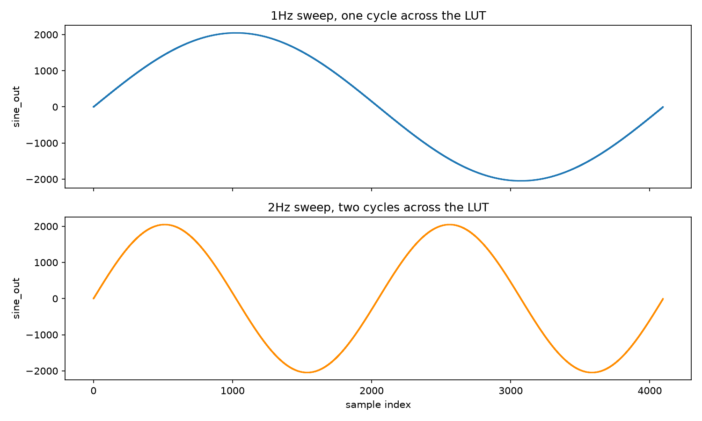

# Sine Wave Simulations

The sine look up table (LUT) [[sine_lut.sv](../../rtl/dds/lut/sine_lut.sv)] samples a sine wave broken up into 4096 12-bit signed 2's complement binary values. This sine wave is stored in [sine_lut.hex](../../rtl/dds/lut/sine_lut.hex) as HEX.

The rate at which the LUT rate at which the LUT steps through and outputs the sine wave (the frequency) is set by the phase accumulator [[phase_accumulator.sv](../../rtl/dds/phase_accumulator.sv)]. 

A higher phase increment value means the phase increases at a faster rate and thus the LUT address increases faster, looping through the sine wave's values faster. 

The LUT address is the top 12 bits of the 32 bit phase. As an example, if the phase were to increase by +1 each cycle, the address would not increase until 1,048,576 cycles have passed. (Most of the time the phase would increment by a lot more than +1 each cycle). If it were to increase by +2 each cycle, it would take 524,288 until the address moved onto the next value.

The image below shows two output traces from the Sine LUT. One at 1 Hz and another at 2 Hz. In this example the frequencies here are arbitray.

*Each wave looks very smooth as each cycle as 4,096 samples.*

